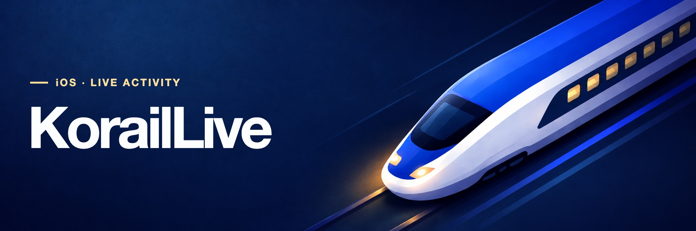
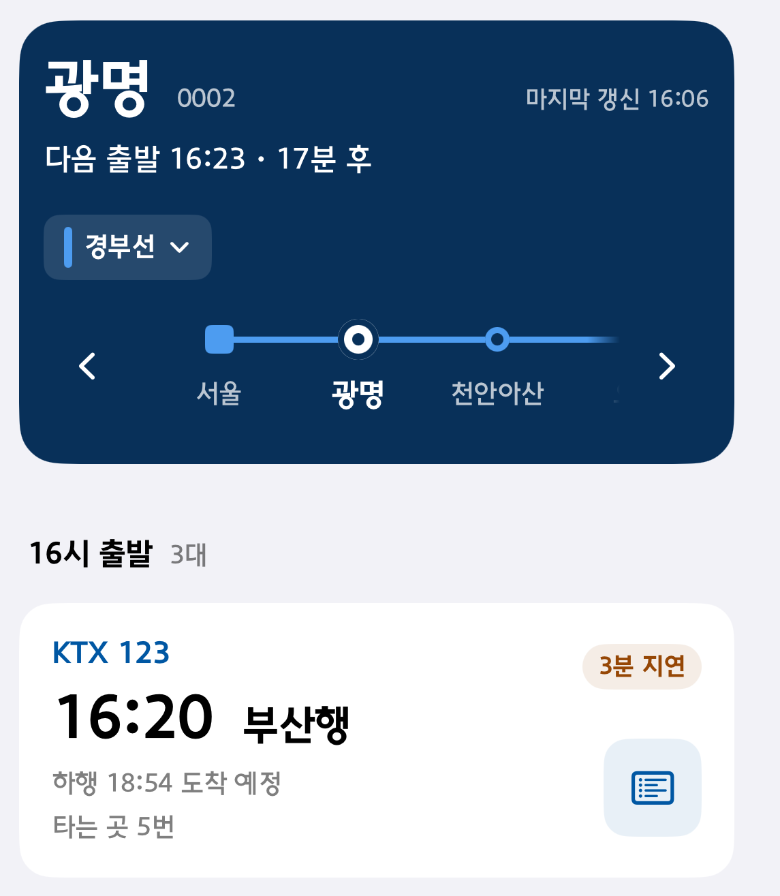
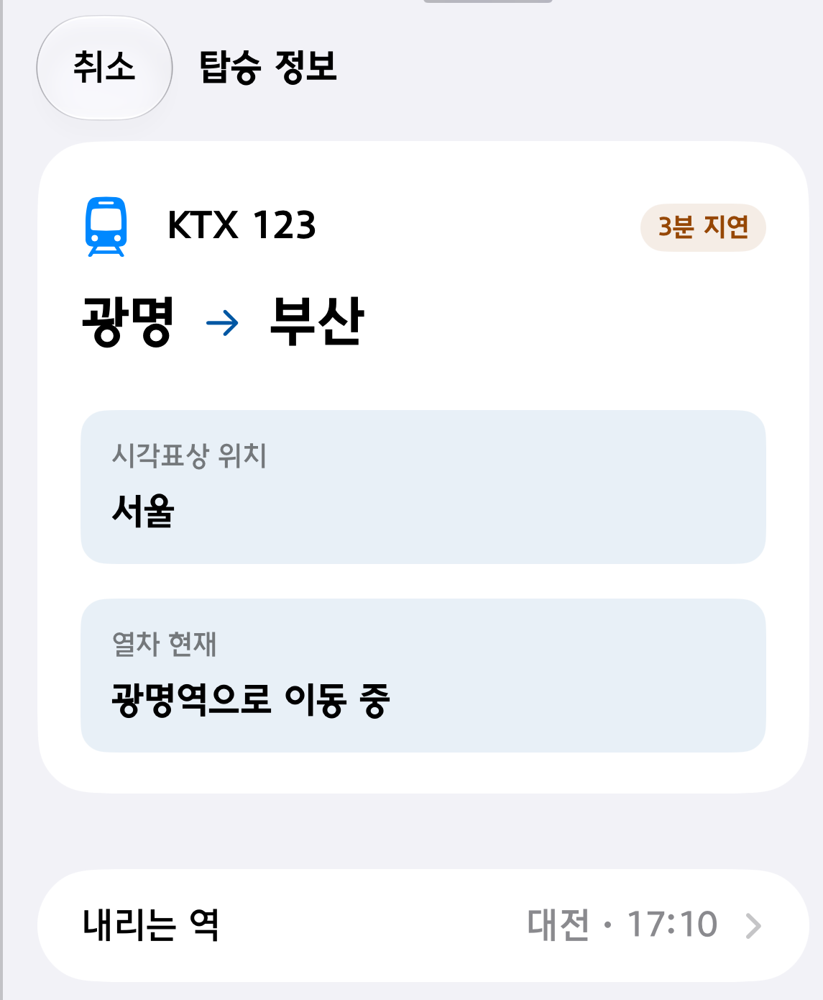
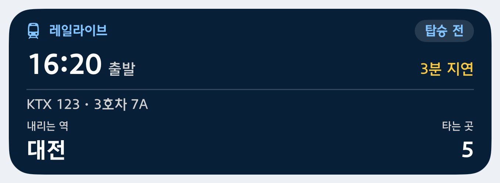
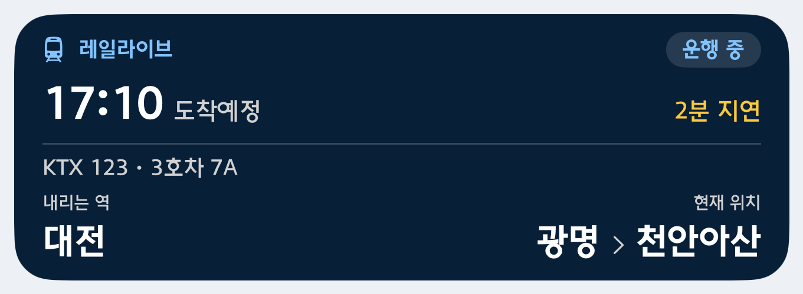
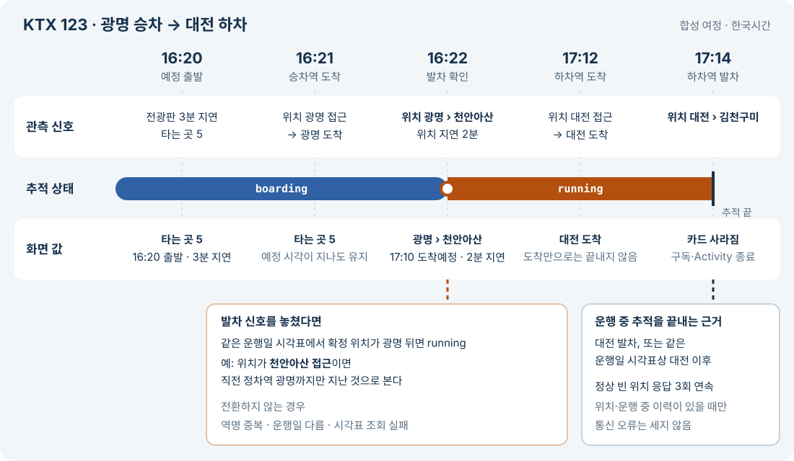
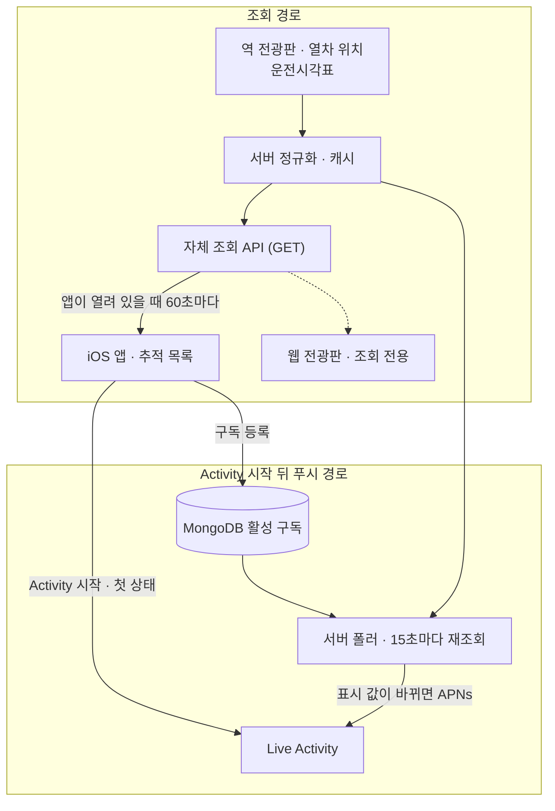
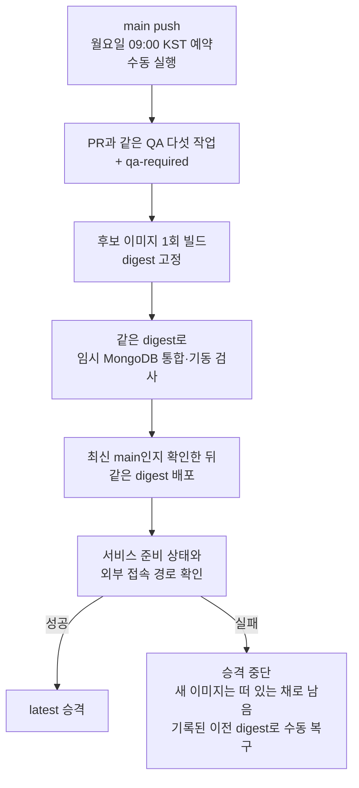

# KorailLive



KorailLive는 iPhone 잠금화면에 열차의 **타는 곳**을 보여 주다가, 승차역 발차가 확인되는 순간 그 자리를 **현재 위치**로 바꾼다.

**직접 구현한 범위** · SwiftUI·ActivityKit iOS 앱과 Live Activity 위젯, Node.js·Express·MongoDB 서버와 APNs 폴러, React 웹 전광판, GitHub Actions 검사·배포.

## 광명에서 타고 대전에서 내리는 한 여정

전광판이 3분 지연을 알린 광명역에서 부산행 KTX 123을 타고 종착역보다 앞선 대전에서 내린다. 열차번호, 시각, 지연, 좌석은 합성 값이다.

| 광명역 전광판 · 16:20 예정, 3분 지연, 타는 곳 5 | 탑승 정보 · 하차역 대전 17:10 |
| :---: | :---: |
|  |  |

<sub>iPhone Duo 시뮬레이터(iOS 27.2)에서 앱을 실행해 캡처하고 필요한 부분만 잘랐다. 서버 응답만 합성 데이터로 바꿨다.</sub>

하차역 후보는 운전시각표에서 광명 뒤의 정차역만 남기므로 통과역 오송은 빠진다. 카드에는 종착역 부산의 도착 시각(18:54) 대신 승객이 고른 대전의 도착 시각(17:10)이 나간다. 서버도 폴링 중에 이 값을 열차 종착 시각으로 덮어쓰지 않는다.

| 탑승 전 · 예정 시각이 지나도 타는 곳 | 운행 중 · 같은 자리에 현재 위치 |
| :---: | :---: |
|  |  |

<sub>위젯 확장의 잠금화면 뷰 코드를 같은 시뮬레이터의 앱 화면에 렌더링한 프리뷰다. 시스템 잠금화면이나 실기기 푸시 수신을 촬영한 화면이 아니다. 머리글의 ‘레일라이브’는 앱의 한국어 표시 이름이다.</sub>

두 카드의 열차번호, 승차역, 타는 곳, 전광판 지연 3분, 위치 지연 2분은 서버 QA 시나리오 `PHASE-001`과 같다. 시각과 하차역 대전은 화면용으로 정한 값이다. 이 시나리오는 시계를 15초씩 넘기며 실제 서버 폴러를 다섯 번 돌린다. 다섯 번 모두 전광판 조회가 실패하도록 꾸며 위치 신호만으로 판단하게 한다.

| 위치 응답 | 기대 결과 |
| --- | --- |
| 없음, 광명 접근, 광명 도착 | `boarding`, 타는 곳 5 |
| 광명 › 천안아산, 위치 지연 2분 | `running`, 타는 곳 빈 값, 지연 2분 |
| 통신 오류 | `running`, 지연 2분 그대로 |

시나리오 시계는 광명 예정 출발보다 40분 늦게 고정돼 있다. 예정 시각이 지났다는 사실만으로는 단계가 바뀌지 않는지도 같이 확인하는 셈이다.

## 타는 곳이 현재 위치로 바뀌는 지점

**예정 시각이 지나도, 열차가 광명에 도착해도 `boarding`이다.** 위치가 `광명 › 천안아산`으로 바뀌어 승차역 발차가 확인돼야 `running`이 된다.



발차 신호를 놓쳐도 같은 운행일의 시각표에서 확정 위치가 광명 뒤라면 `running`으로 바꾼다. 위치가 어떤 역에 *접근* 중이면 그 역 바로 앞의 정차역까지만 지난 것으로 센다. 역명이 시각표에 두 번 나오거나, 운행일이 다르거나, 시각표 조회가 실패하면 전환하지 않는다.

**대전에 도착하는 것만으로는 끝내지 않는다.** 운행 중인 추적은 대전 발차나 같은 운행일 시각표상 대전 이후 진행이 확인되면 구독과 Activity를 끝낸다. 종료는 상태 필드의 세 번째 값이 아니다. 위치나 운행 중 이력이 있는 열차라면 정상 빈 위치 응답이 3회 연속일 때도 끝내며 통신 오류는 이 횟수에 넣지 않는다.

## 데이터가 잠금화면까지 오는 길

**잠금화면 카드는 서버 폴러가 APNs로 갱신한다.** 앱은 Activity를 시작하면서 첫 상태만 만들고 열려 있는 동안 60초마다 서버 API를 조회해 앱 안의 추적 목록과 위치를 갱신한다. 서버 폴러는 이전 사이클이 끝나고 15초 뒤에 다시 조회한다. 두 경로 모두 같은 정규화 결과를 쓴다.



외부 철도 자료는 서버만 조회한다. 웹 전광판은 같은 조회 API를 읽기만 하며 구독이나 푸시를 만들지 않는다.

## 판단 근거가 보이는 코드

아래 코드는 비공개 저장소의 현재 구현(iOS `00a3d2b`, 서버 `d96b5ba`)에서 가져왔다. 각 블록 위에 그대로 옮겼는지, 공개용으로 줄였는지 적었다.

### 발차 신호를 놓쳐도 어떻게 운행 중임을 아는가

**같은 운행일의 시각표를 확인한 뒤에만 정차 순서를 비교한다.** 아래는 서버 `services/poller.js`의 `hasPassedStation` 원문이다.

```javascript
async function hasPassedStation(sub, location, stationName) {
  if (!stationName) return false;
  if (hasDepartedBoarding(stationName, location)) return true;
  if (!location.currentStation || !location.scheduledDeparture) return false;
  try {
    const dateYmd = new Date((location.scheduledDeparture + 9 * 3600) * 1000).toISOString().slice(0, 10).replaceAll("-", "");
    const schedule = await getTrainSchedule(
      trimLeadingZeros(sub.trainNumber.replace(/\D/g, "")), dateYmd,
      sub.trainNumber.startsWith("SRT") ? "S" : "K"
    );
    const scheduleDay = new Date((schedule.operatingDate + 9 * 3600) * 1000).toISOString().slice(0, 10).replaceAll("-", "");
    return scheduleDay === dateYmd && hasPassedBoarding(stationName, location, schedule.stops);
  } catch {
    // 조회 실패나 운행일 불일치를 역 통과로 해석하지 않는다.
    return false;
  }
}
```

정차 순서 판정은 서버 `services/contentState.js`의 `hasPassedBoarding` 원문이다.

```javascript
function hasPassedBoarding(stationName, location, stops) {
  const names = stops.map((stop) => normalizedStationName(stop.stationName));
  const boarding = normalizedStationName(stationName);
  const current = normalizedStationName(location.currentStation);
  const next = normalizedStationName(location.nextStation);
  if (!boarding || !current || !next || ["정차", "대기", "회송", "..."].includes(next) || next.includes("운행")) return false;
  // 같은 역이 여러 번 나오는 시각표는 어느 방문인지 확정할 수 없다.
  if (names.filter((name) => name === boarding).length !== 1 || names.filter((name) => name === current).length !== 1) return false;
  const boardingIndex = names.indexOf(boarding);
  const currentIndex = names.indexOf(current);
  if (currentIndex <= boardingIndex) return false;
  if (next !== "접근") return true;
  const previousStop = stops.slice(0, currentIndex).findLastIndex((stop) => stop.stopType !== "pass");
  return previousStop >= boardingIndex;
}
```

`천안아산 접근`은 열차가 아직 천안아산에 닿지 않았다는 뜻이라서 천안아산 앞의 마지막 정차역까지만 지난 것으로 본다. 데모 시각표(서울, 광명, 천안아산, 오송 통과, 대전 …)에서 결과는 이렇다.

| 놓친 뒤 받은 위치 | 결과 |
| --- | --- |
| 천안아산 접근 | 직전 정차역이 광명(승차역)이므로 `true`, `running` |
| 광명 접근 | 현재역이 승차역보다 앞서지 않으므로 `false`, `boarding` 유지 |
| 운행일이 다른 시각표, 조회 실패 | `false`, `boarding` 유지 |

### 현재 지연이 0분이거나 자료가 비면 무엇을 보여 주는가

**탑승 전에는 전광판 지연만, 운행 중에는 현재 위치 지연 → 같은 운행의 직전 위치 지연 → 전광판 지연 순서로 고른다.** 서버 `services/contentState.js`의 `buildContentStateFromNormalized`에서 지연 부분만 남기고 줄였다.

```javascript
const operatingDate = location.scheduledDeparture
  ? new Date((location.scheduledDeparture + 9 * 3600) * 1000).toISOString().slice(0, 10)
  : train.operatingDate || null;
const sameOperation = !!operatingDate && operatingDate === lastState?.delayOperatingDate;
const currentGisDelay = location.delayAvailable !== false && Number.isFinite(location.delayMinutes)
  ? location.delayMinutes : null;
const lastGisDelay = sameOperation && Number.isFinite(lastState?.lastGisDelayMinutes)
  ? lastState.lastGisDelayMinutes : null;
const tidsDelay = train.delayAvailable !== false && Number.isFinite(train.delayMinutes)
  ? train.delayMinutes : null;
const chosenDelay = departedBoarding ? (currentGisDelay ?? lastGisDelay ?? tidsDelay) : tidsDelay;
// 정수 필드는 구버전 디코더를 위해 유지하고, false만 미제공을 뜻한다.
const delayMinutes = chosenDelay ?? 0;
// (중략) 반환 객체의 지연 관련 필드
//   delayMinutes,
//   delayAvailable: chosenDelay !== null,
```

`Number.isFinite`와 `??`는 0을 값으로 남긴다. 그래서 0분은 ‘정시운행’, 자료가 아예 없으면 `delayAvailable: false`로 ‘지연 정보 없음’이 된다. 직전 위치 지연은 운행일이 같을 때 저장한 값만 쓴다. 운행일은 위치 응답의 시발 예정 시각으로 정하고, 그 값이 없으면 구독에 기록된 운행일을 쓴다.

| 데모 입력 | 카드 표시 |
| --- | --- |
| 탑승 전, 전광판 3분 | 3분 지연 |
| 운행 중, 위치 2분 | 2분 지연 |
| 운행 중, 위치 0분 (전광판 3분) | 정시운행 |
| 운행 중, 위치 지연 없음, 같은 운행의 직전 위치 2분 | 2분 지연 |
| 운행 중, 세 값 모두 없음 | 지연 정보 없음 |

### 서버가 정한 단계는 잠금화면의 어느 줄을 바꾸는가

**위젯은 `status` 하나로 오른쪽 칸을 ‘타는 곳’과 ‘현재 위치’ 중 하나로 고른다.** 앱이 Activity를 처음 열 때도 같은 기준으로 첫 상태를 만들어 화면이 튀지 않게 한다. iOS `KorailLive/Shared/TrainStatus.swift`에서 단계와 타는 곳 필드만 남기고 줄였다.

```swift
func makeActivityState(carNumber: String, seatNumber: String, currentStation: String = "", nextStation: String = "") -> TrainLiveActivityAttributes.ContentState {
    let departedBoarding = trackingPhase == "running" || TrainTrackingPhase.hasDepartedBoarding(
        stationName: stationName, currentStation: currentStation, nextStation: nextStation
    )
    return TrainLiveActivityAttributes.ContentState(
        // (중략) 시각·지연·호차·좌석·위치 필드
        platform: departedBoarding ? "" : platform,
        status: departedBoarding ? "running" : "boarding"
        // (중략) 지연 출처 필드
    )
}
```

위젯은 `KorailLive/Widget/KorailLiveWidgets.swift`에서 이 값을 읽는다. `isRunningPhase`는 원문이고 표시 분기는 글꼴·색 수정자를 지우고 줄였다.

```swift
var isRunningPhase: Bool {
    if let status {
        return status == "running"
    }
    return TrainTrackingPhase.hasDepartedBoarding(
        stationName: stationName, currentStation: currentStation, nextStation: nextStation
    )
}

// 잠금화면 카드의 오른쪽 칸
Text(presentation.isRunningPhase ? "현재 위치" : KorailMode.platformLabel)
if presentation.isRunningPhase {
    if let statusText = presentation.destinationStatusText {
        Text(statusText)                    // "대전 접근", "대전 도착"
    } else {
        IslandTrainLocationInline(presentation: presentation, fontSize: valueFontSize, arrowSize: 12)  // "광명 › 천안아산"
    }
} else {
    Text(presentation.compactPlatformText)  // "5", 모르면 "대기"
}
```

데모의 두 카드에서 `status`가 `boarding`이면 ‘타는 곳 5’, `running`이면 ‘현재 위치 광명 › 천안아산’이 나온다. `status` 필드가 생기기 전에 시작한 Activity나 예전 푸시에는 이 값이 없다. 그때도 시간으로 추측하지 않고 위치가 `광명 › 천안아산`처럼 승차역을 떠났는지로 판정한다.

## GitHub Actions에서 같은 판단을 검사하고 배포하기

**서버 저장소의 PR 검사는 다섯 작업이 모두 성공해야 `qa-required`가 통과하고, main은 검사를 통과한 이미지 digest 그대로 운영에 올라간다.**

| 작업 | 확인하는 것 |
| --- | --- |
| `baseline` | 서버 문법 검사, 회귀 테스트, 런타임 의존성 보안 감사 |
| `scenarios` | 고정 시계와 합성 응답으로 실제 폴러를 돌리는 정책 시나리오(`PHASE-001` 포함), 실패 재현 도구 검사 |
| `integration` | 임시 MongoDB와 Docker 이미지로 HTTP 처리와 운영 진입점 기동 |
| `web` | 웹 전광판 빌드, 정책 테스트, 브라우저 검사, 의존성 감사 |
| `swift` | 고정한 iOS 커밋에서 앱 정책 회귀 검사와, 서버가 만든 REST·시각표·APNs 응답의 실제 Swift 모델 디코딩 |

다섯 작업이 모두 `success`여야 집계 작업 `qa-required`가 성공한다. 실패, 취소, 예상하지 못한 건너뜀은 성공으로 바꾸지 않는다. 실패한 시나리오는 기대값과 실제값, 입력·정책·DB·APNs 사건을 결과 파일에 남기고 같은 서버 커밋과 해시에서 그대로 다시 돌릴 수 있다. Actions 산출물 보관 설정은 14일이다.

다만 `qa-required`는 병합을 막는 필수 검사로 등록돼 있지 않다. 비공개 저장소 요금제에서 브랜치 보호 API가 HTTP 403을 돌려주기 때문이다. 그래서 병합 전에 PR의 검사 결과를 직접 확인한다.

2026년 11월 25일 main 실행에서 `swift` 작업은 iOS 커밋 `e8fc642`를 받아 정책 회귀 검사와 Swift 디코딩 검사를 모두 통과했고 `scenarios` 작업에서 `PHASE-001`도 통과했다. 이 검사들은 실기기가 Live Activity 푸시를 받는지까지 확인하지 않는다. 그 부분은 실기기에서 따로 본다.

배포는 ‘검사한 이미지가 그대로 운영에 올라가는가’에 답하도록 짰다.



배포 뒤 확인이 실패하면 `latest`를 올리지 않는다. 이때 새 이미지는 이미 기동된 채로 남고 자동 롤백은 없다. 이전 정상 이미지로 되돌리는 일은 기록된 digest로 사람이 실행한다. 같은 날 main 실행에서는 QA 다섯 작업, 후보 빌드, 배포, 승격이 모두 성공했다.

운영 중인 API는 `qa-live.yml`이 따로 본다. 매일 09:10 KST 예약이나 수동 실행으로 공개 API에 GET을 최대 20번 보내 HTTP 상태와 응답 형식을 확인하며 PR 검사와는 분리돼 있다. 아직 main에 병합되지 않은 PR QA 자문 작업(`qa-advice.yml`)은 기본 비활성이고 `qa-required` 집계에 들어가지 않는다.
