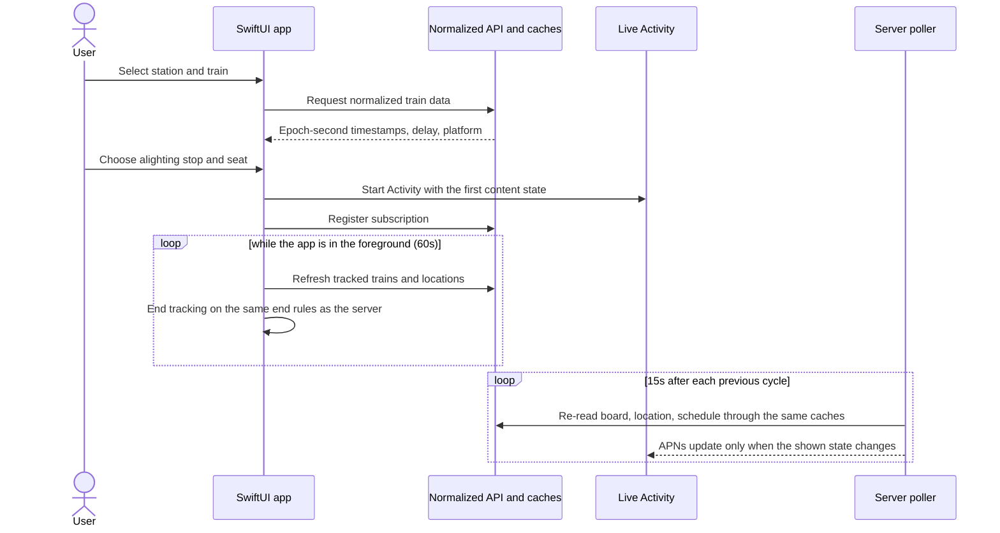

# Architecture

## Production shape

iOS 앱과 웹 전광판은 서버가 정리한 운행 정보를 공유합니다.

```text
Native iOS (SwiftUI)
  ├─ SwiftData / UserDefaults / Keychain
  ├─ ActivityKit + WidgetKit
  └─ server API client

Web departure board (React)
  └─ read-only server API client

Node.js service
  ├─ normalized read API
  ├─ request-coalescing caches
  ├─ subscription persistence (MongoDB)
  └─ background poller + APNs live-update delivery
```

공개 저장소에는 이 구조의 경계와 판단 로직 발췌만 두고, 운영 gateway 내부는 검은 상자로 취급합니다. 앱의 60초 포그라운드 조회와 서버 폴러의 15초 재조회·APNs 경로는 [README](../README.md#데이터가-잠금화면까지-오는-길)에 그림으로 정리했습니다.

## Search-to-live-update flow



## Shared invariants

### Time

- API 시간은 Unix timestamp 초 단위입니다.
- 운행일 계산과 사용자 표시는 `Asia/Seoul` 기준입니다.
- 승차역 발차 또는 같은 운행일의 시각표상 승차역 이후 진행을 확인하면 운행 중으로 전환합니다.
- 시각표가 자정을 넘을 때 시각이 역행하면 다음 날짜로 정규화합니다.

### State ownership

- 서버 응답이 제공하는 단계가 권위값입니다.
- 앱의 초기 상태도 같은 발차 기준으로 계산해 첫 화면의 점프를 방지합니다.
- 확정된 현재역·다음역과 좌표 기반 최근접역 추정은 서로 다른 필드로 유지합니다.
- 비동기 작업은 generation 또는 revision을 확인한 뒤에만 상태를 commit합니다.

### Failure handling

- 캐시는 값뿐 아니라 진행 중인 요청도 공유해 동일 키의 중복 조회를 병합합니다.
- 일시적인 upstream 또는 push 실패는 종료 신호가 아니라 재시도 가능한 상태입니다.
- 앱 재시작 시 로컬 여정, OS live surface와 서버 구독을 대조해 복원합니다.
